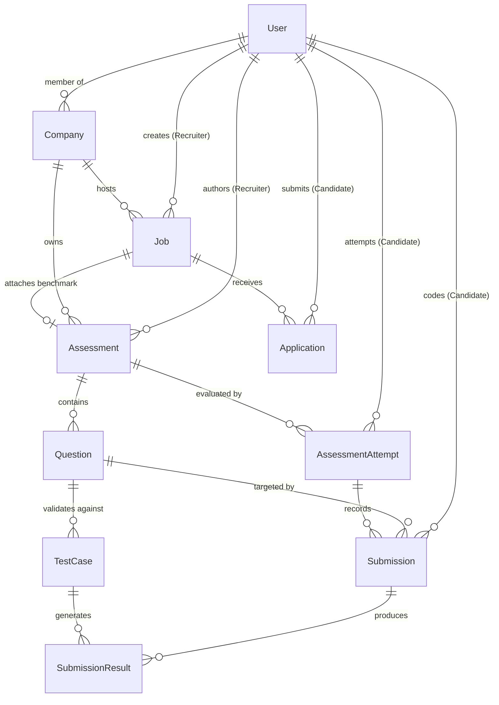

# DevHire — Smart Technical Recruitment & Coding Assessment Platform

> **Portfolio Project — Placement & Enterprise Technical Evaluation System**  
> *Phase 1 Foundation: Next.js 16 App Router • TypeScript (Strict) • Tailwind CSS v4 • shadcn/ui • PostgreSQL • Prisma ORM*

---

## 1. Project Overview

**DevHire** is a modern, high-precision Technical Recruitment and Coding Assessment SaaS platform engineered to transform the software engineering hiring lifecycle. By shifting the evaluation paradigm from resume keyword matching to verified, sandboxed coding challenges, DevHire provides candidate-centric skill verification alongside recruiter-grade talent benchmarking.

### Core Roles
- **Candidates**: Build a verified technical passport, complete proctored coding assessments across algorithms, concurrency, and systems design, browse transparent technical opportunities, and track application milestones.
- **Recruiters & Engineering Leaders**: Post technical vacancies with attached assessments, monitor applicant pipelines scored by objective algorithmic test cases, inspect pass-rate analytics across technical domains, and shortlist high-percentile developers.

> [!NOTE]
> **Phase 1 Scope Note**: DevHire is currently in **Phase 1 (Project Foundation)**. All dashboard views render structured, labeled mock data to illustrate dashboard architecture, ergonomic UX, and domain entities. Live database queries, authentication sessions, and code execution sandboxes will be activated in subsequent phases.

---

## 2. Technology Stack

| Layer | Technology | Purpose |
|---|---|---|
| **Framework** | [Next.js 16](https://nextjs.org/) (App Router, Turbopack) | High-performance React framework with server components and edge-ready routing |
| **Language** | [TypeScript 5](https://www.typescriptlang.org/) (Strict Mode) | Full type safety across domain models, props, and schema definitions |
| **Styling** | [Tailwind CSS v4](https://tailwindcss.com/) | Modern utility-first CSS engine with dark navy & charcoal SaaS design system |
| **Icons** | [Lucide React](https://lucide.dev/) | Clean, accessible iconography |
| **Component System** | shadcn/ui & CVA | Accessible, composable UI primitives (`Button`, `Card`, `Badge`) |
| **ORM** | [Prisma ORM 7](https://www.prisma.io/) | Declarative schema modeling, migrations management, and typed client generation |
| **Database** | [PostgreSQL](https://www.postgresql.org/) | Relational database engine for users, assessments, questions, test cases, and submissions |
| **Package Manager** | npm | Deterministic dependency management |

---

## 3. Implemented vs. Planned Features

### Phase 1: Foundation (Completed)
- [x] **Next.js Project Initialization**: Clean App Router setup with strict TypeScript and Turbopack.
- [x] **Premium Dark SaaS Landing Page (`/`)**:
  - DevHire branding and responsive navigation bar with mobile drawer.
  - Hero heading: *"Hire Smarter. Prove Your Skills."*
  - Dual CTAs for Candidates and Recruiters.
  - Interactive terminal code editor showcase with passing public & hidden test badges.
  - Technical features overview (sandboxing, hidden tests, analytics).
  - Four-step "How DevHire Works" recruitment lifecycle flow.
  - Architectural credits and rich footer.
- [x] **Candidate Dashboard (`/candidate/dashboard`)**:
  - Full sidebar navigation with role switcher.
  - Candidate profile overview card (Alex Chen) with verified skill tags and percentile benchmarks.
  - Upcoming technical assessments preview with difficulty badges, deadlines, and action buttons.
  - Active application tracker with stage badges ("Assessment Invited", "In Review", "Shortlisted").
  - Available technical roles preview with transparent compensation ranges and skill requirements.
  - Explicit Phase 1 Mock Data disclaimer banner.
- [x] **Recruiter Dashboard (`/recruiter/dashboard`)**:
  - Full sidebar navigation with role switcher.
  - Hiring overview metrics (open roles, total applicants, assessments conducted, shortlist rate).
  - Active job postings preview with applicant counts and live assessment counters.
  - Candidate applications pipeline table with match scores and assessment percentages.
  - Assessment statistics and domain pass-rate analytics.
  - Explicit Phase 1 Mock Data disclaimer banner.
- [x] **Reusable UI Component Architecture**:
  - `Button` with accessible focus rings, gradient accents, and sizes.
  - `Card`, `CardHeader`, `CardTitle`, `CardDescription`, `CardContent`, `CardFooter`.
  - `Badge` with semantic variants (success, warning, danger, violet, indigo, mock).
  - `MockDataBanner` for transparent prototype signaling.
  - `Sidebar`, `Navbar`, `Footer`, `DashboardHeader`.
- [x] **Prisma Database Schema (`prisma/schema.prisma`)**:
  - 10 complete relational models: `User`, `Company`, `Job`, `Application`, `Assessment`, `Question`, `TestCase`, `AssessmentAttempt`, `Submission`, `SubmissionResult`.
  - Candidate & recruiter role separation (`Role` enum).
  - Hidden test cases flagged server-side (`isHidden Boolean @default(false)`).
  - Password hashing field (`passwordHash` — never plaintext).
  - Indexes, unique constraints, and audit timestamps.
- [x] **Environment Configuration**: Template `.env.example` with setup guide.
- [x] **Zero-Database Offline Operation**: Landing page and mock dashboards execute fully without requiring an active PostgreSQL connection.

### Phase 2: Core Platform & Auth (Roadmap)
- [ ] User authentication with NextAuth / Auth.js (OAuth + Email/Password with bcrypt/argon2).
- [ ] Protected routes, session middleware, and role-based access control (RBAC).
- [ ] Live PostgreSQL connection and automated migrations.
- [ ] Candidate profile editing and resume upload.
- [ ] Recruiter job creation and applicant review workflows.

### Phase 3: Code Execution Engine (Roadmap)
- [ ] Isolated code execution sandbox (Judge0 / Dockerized microservice).
- [ ] Multi-language runner for TypeScript, Python, and Go.
- [ ] Automated evaluation of public and hidden server-side test cases.
- [ ] Anti-cheat telemetry and code playback.

---

## 4. Folder Structure

```
devhire/
├── prisma/
│   ├── schema.prisma            # 10 core PostgreSQL models, relationships, and enums
│   └── migrations/              # Database migration histories (Phase 2)
├── prisma.config.ts             # Prisma configuration file (Prisma 7 standard)
├── public/                      # Static assets and icons
├── src/
│   ├── app/
│   │   ├── candidate/
│   │   │   └── dashboard/
│   │   │       └── page.tsx     # Candidate Dashboard route (/candidate/dashboard)
│   │   ├── recruiter/
│   │   │   └── dashboard/
│   │   │       └── page.tsx     # Recruiter Dashboard route (/recruiter/dashboard)
│   │   ├── globals.css          # Dark navy & charcoal theme, variables, custom scrollbar
│   │   ├── layout.tsx           # Root Next.js layout and font configurations
│   │   └── page.tsx             # DevHire Marketing Landing Page (/)
│   ├── components/
│   │   ├── layout/
│   │   │   ├── navbar.tsx       # Marketing header with responsive mobile drawer
│   │   │   ├── footer.tsx       # Platform footer with tech stack and architecture links
│   │   │   ├── sidebar.tsx      # Dual-role stationary navigation sidebar with role toggle
│   │   │   ├── dashboard-header.tsx # Breadcrumbs, page headers, and quick actions
│   │   │   ├── dashboard-layout.tsx # 100dvh stationary sidebar shell with scrollable content panel
│   │   │   └── mobile-sidebar-drawer.tsx # Accessible mobile drawer with keyboard controls
│   │   └── ui/
│   │       ├── back-to-top.tsx  # Smooth back-to-top floating button attached to content scroll
│   │       ├── button.tsx       # Reusable button with CVA variants
│   │       ├── card.tsx         # Reusable dark SaaS card family
│   │       ├── badge.tsx        # Status and mock indicator badges
│   │       └── mock-banner.tsx  # Transparent Phase 1 mock notice banner
│   ├── features/
│   │   ├── assessments/
│   │   │   └── data/
│   │   │       └── mock-assessments.ts # Technical assessment benchmark fixtures
│   │   ├── candidate/
│   │   │   ├── components/
│   │   │   │   ├── profile-overview-card.tsx
│   │   │   │   ├── available-jobs-preview.tsx
│   │   │   │   ├── upcoming-assessments-preview.tsx
│   │   │   │   └── application-status-preview.tsx
│   │   │   └── data/
│   │   │       └── mock-candidate.ts   # Candidate profile and application records
│   │   ├── jobs/
│   │   │   └── data/
│   │   │       └── mock-jobs.ts        # Technical job vacancy listings
│   │   └── recruiter/
│   │       ├── components/
│   │       │   ├── hiring-overview-metrics.tsx
│   │       │   ├── active-job-postings-preview.tsx
│   │       │   ├── candidate-applications-preview.tsx
│   │       │   └── assessment-statistics-preview.tsx
│   │       └── data/
│   │           └── mock-recruiter.ts   # Recruiter metrics, pipeline, and analytics
│   ├── lib/
│   │   ├── prisma.ts            # Global singleton Prisma client
│   │   └── utils.ts             # cn helper, formatCurrency, and formatDate
│   └── types/
│       └── index.ts             # Domain interfaces, enums, and data contracts
├── .env.example                 # Environment variables template
├── .gitignore                   # Excludes node_modules, build artifacts, secrets
├── package.json                 # Dependencies and build scripts
├── tsconfig.json                # TypeScript strict configuration with path aliases
└── README.md                    # Engineering documentation
```

---

## 5. Database Schema Architecture

The database schema is modeled in [`prisma/schema.prisma`](prisma/schema.prisma) with 10 relational entities:



### Security & Integrity Highlights
- **Hidden Test Cases (`isHidden Boolean @default(false)`)**: Flagged at the database level so the candidate-facing UI never leaks edge cases or expected outputs.
- **Password Hashes (`passwordHash String`)**: Pre-configured for salted bcrypt/argon2 hashing in Phase 2; plaintext passwords will never touch database columns.
- **Relational Integrity**: Foreign keys leverage `onDelete: Cascade` for dependent questions and test cases, while critical recruiter-authored audits utilize `onDelete: Restrict`.

---

## 6. Local Installation & Development

### Prerequisites
- **Node.js**: `v20.0.0` or higher (tested on Node `v25.1.0`)
- **npm**: `v10.0.0` or higher
- **PostgreSQL** *(optional for Phase 1)*: Local instance or Supabase/Neon connection string

### Step 1: Clone Repository
```bash
git clone <repository-url>
cd devhire
```

### Step 2: Install Dependencies
```bash
npm install
```

### Step 3: Setup Environment
```bash
cp .env.example .env
```
*(No edits to `.env` are required for Phase 1. The application runs mock data without an active database.)*

### Step 4: Run Development Server
```bash
npm run dev
```

Navigate to `http://localhost:3000` in your browser.

---

## 7. Development & Verification Commands

| Command | Purpose |
|---|---|
| `npm run dev` | Starts the Next.js development server with Turbopack |
| `npm run build` | Generates the Prisma client and compiles production build |
| `npm run start` | Boots the production server |
| `npm run lint` | Runs ESLint to verify code quality and style rules |
| `npm run type-check` | Executes strict TypeScript compiler checks (`tsc --noEmit`) |
| `npm run prisma:validate` | Validates Prisma schema syntax and relation rules |
| `npm run prisma:generate` | Generates typed Prisma Client into `node_modules/@prisma/client` |

---

## 8. Deployment Instructions (Vercel)

DevHire is configured for zero-configuration deployment to [Vercel](https://vercel.com).

### Preparing for Vercel
1. Ensure the build script generates the Prisma Client:
   ```json
   "build": "prisma generate && next build"
   ```
   *(Already configured in `package.json`)*.
2. In the Vercel Project Dashboard:
   - Framework Preset: **Next.js**
   - Root Directory: `./`
   - Build Command: `npm run build`
   - Output Directory: `.next`
3. Configure Environment Variables in Vercel settings:
   - `DATABASE_URL`: Your production PostgreSQL connection string (Supabase / Neon / AWS RDS).
   - `NEXT_PUBLIC_APP_URL`: Your production domain URL.

> [!CAUTION]
> Per deployment guidelines, do **NOT** push to GitHub or trigger Vercel deployment without explicit user authorization.

---

## 9. Engineering Standards

- **Strict TypeScript**: No implicit `any`, explicit interfaces for all component props, types, and mock fixtures.
- **Accessible UI/UX**: Keyboard navigation support, visible focus rings (`focus-visible:ring-blue-500`), semantic HTML5 landmarks (`header`, `main`, `aside`, `nav`, `footer`).
- **Clean Architecture**: Clear separation of concerns between UI primitives, layout structures, and domain features (`src/features/*`).
- **Documentation Integrity**: Clear explanatory comments, environment templates, and architectural diagrams.
