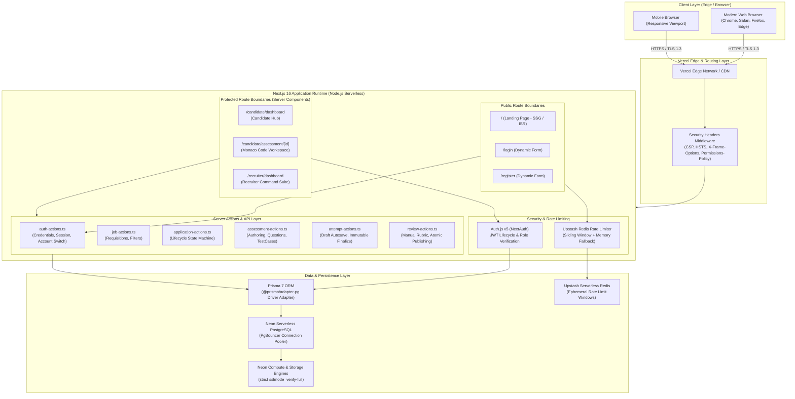
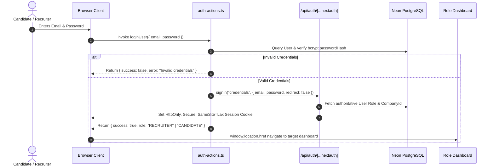
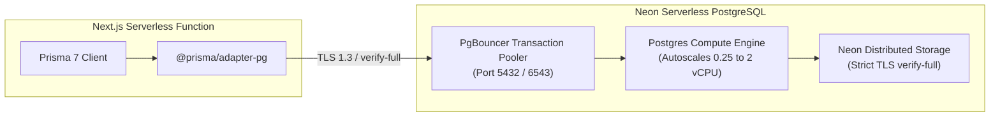
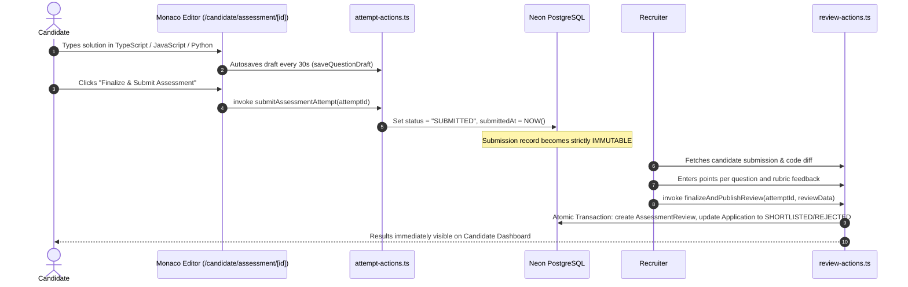

# DevHire — System Architecture

This document provides a comprehensive technical reference for the DevHire recruitment platform architecture, detailing system components, request lifecycles, security boundaries, and operational constraints.

---

## 1. High-Level Architecture

DevHire is built on a modern, decoupled serverless architecture leveraging Next.js 16 App Router, Auth.js v5, Prisma 7 ORM, Neon Serverless PostgreSQL, and Upstash Redis.

---

## 2. Next.js 16 App Router Architecture

### 2.1 Server Components vs. Client Components Boundary

DevHire strictly adheres to the React Server Components (RSC) architecture:

1. **Page Shells & Data Fetchers (`page.tsx`)**:
   - Implemented as asynchronous Server Components.
   - Execute database queries server-side via Prisma with direct access to user sessions.
   - Do not ship client-side JavaScript for data fetching, eliminating waterfall network requests.
   - Perform server-side authorization checks before rendering private UI components.

2. **Interactive UI Leaf Components (`'use client'`)**:
   - Used selectively for interactive state: tab selection, modal controls, form input state, and Monaco Editor.
   - Receive pre-fetched, serialized data as immutable props from parent Server Components.
   - Invoke Next.js Server Actions for state mutations with automatic route revalidation via `revalidatePath`.

### 2.2 Dynamic Rendering & Prerender Guarantees

In Next.js 16, dynamic functions (such as `cookies()`, `headers()`, or cryptographic random functions accessed during render) trigger dynamic rendering.

- **Candidate Dashboard (`/candidate/dashboard`)** & **Recruiter Dashboard (`/recruiter/dashboard`)**:
  - Configured with `export const dynamic = 'force-dynamic'` to prevent prerender-time evaluation errors and ensure every request reflects real-time database state.
- **Monaco Assessment Workspace (`/candidate/assessment/[id]`)**:
  - Dynamically rendered to enforce time limits against server clock timestamps (`attempt.expiresAt`), preventing client tampering.

---

## 3. Authentication & Session Architecture

DevHire utilizes **Auth.js v5 (NextAuth.js)** configured with lightweight, stateless **JSON Web Tokens (JWT)**.

### 3.1 Token Lifecycle & Authoritative Role Verification

- **Credentials Provider**: Authenticates against salted `bcryptjs` password hashes. Passwords are never stored in plaintext.
- **JWT Callback**: Enriches the JWT payload with `id`, `role`, and `companyId`.
- **Session Callback**: Maps token claims directly to `session.user`.
- **Database Authoritative Role Resolution**: High-privilege mutations in Server Actions re-verify the user's role against the database to prevent privilege escalation via stale or tampered tokens.

---

## 4. Role-Based Access Control (RBAC) & Multi-Tenancy

DevHire enforces strict multi-tenant isolation across two primary dimensions: **Role Separation** and **Company Multi-Tenancy**.

### 4.1 Role Separation

| Resource / Action | Unauthenticated | Candidate | Recruiter | Enforcement Point |
|---|---|---|---|---|
| View Landing Page & Jobs Directory | ✅ Allowed | ✅ Allowed | ✅ Allowed | Public Route |
| Submit Job Application | ❌ Blocked | ✅ Allowed (Candidate only) | ❌ Blocked | `applyToJob` Server Action |
| Start Assessment Attempt | ❌ Blocked | ✅ Allowed (Invited candidate only) | ❌ Blocked | `startAssessmentAttempt` Action |
| Submit Code Solution | ❌ Blocked | ✅ Allowed (Attempt owner only) | ❌ Blocked | `submitAssessmentAttempt` Action |
| Create Job Requisitions | ❌ Blocked | ❌ Blocked | ✅ Allowed (Company recruiter) | `createJob` Action |
| Create Assessments & Test Cases | ❌ Blocked | ❌ Blocked | ✅ Allowed (Company recruiter) | `createAssessment` Action |
| Issue Candidate Invitations | ❌ Blocked | ❌ Blocked | ✅ Allowed (Company recruiter) | `createAssessmentInvitation` Action |
| Grade & Publish Manual Review | ❌ Blocked | ❌ Blocked | ✅ Allowed (Company recruiter) | `finalizeAndPublishReview` Action |

### 4.2 Multi-Tenant Company Isolation

Recruiters are bound to a single `companyId`. Every database query in recruiter actions scopes filters to `where: { companyId: session.user.companyId }`:
- Recruiters cannot view, edit, or delete jobs owned by other companies.
- Recruiters cannot inspect candidate submissions or invite candidates for other organizations.
- Candidates have isolated access strictly to their own applications, invitations, and attempts.

---

## 5. Database Architecture & Neon Pooling

### 5.1 Connection Management via `@prisma/adapter-pg`

DevHire implements `@prisma/adapter-pg` to enable pooled database connectivity inside short-lived Vercel serverless functions:
- Neon connection strings are transformed to force `sslmode=verify-full`, ensuring cryptographic certificate validation against Neon's root certificate authorities.
- Transaction pooling via PgBouncer prevents connection exhaustion during concurrent traffic spikes.
- Prisma Client is instantiated as a global singleton (`src/lib/prisma.ts`) in development to prevent connection leakage across hot-module reloads.

---

## 6. Rate Limiting Architecture

To protect authentication endpoints and sensitive Server Actions against brute-force and denial-of-service attacks, DevHire implements a dual-tier rate limiting strategy:

1. **Primary Tier: Upstash Redis Sliding Window**:
   - Powered by `@upstash/ratelimit` over REST.
   - Registration: 5 requests per 15-minute sliding window per IP.
   - Login: 10 requests per 15-minute sliding window per IP.
2. **Fallback Tier: In-Memory Token Bucket**:
   - If Redis credentials are unset or the Redis service experiences network interruptions, the application transparently degrades to an in-memory sliding-window store, maintaining continuous security without throwing 500 errors to legitimate users.

---

## 7. Assessment & Manual Review Rubric Workflow

DevHire utilizes an expert-driven manual review model for technical assessment evaluation:

1. **Submission Immutability**: Once an assessment attempt is submitted or expires, the candidate cannot modify code or submit further answers.
2. **Hidden Test Cases Protection**: Public test cases are viewable in the candidate UI for initial verification; hidden test cases are stripped server-side and never sent to candidate client components.
3. **Atomic Publication**: Recruiter rubric scores and qualitative feedback are committed in a Prisma interactive transaction (`$transaction`), guaranteeing that candidate statuses and published reviews are never left in an inconsistent state.

---

## 8. Deployment Architecture & Cloud Infrastructure

| Infrastructure Provider | Role | Free-Tier / Production Quota | Operational Constraint |
|---|---|---|---|
| **Vercel** | Serverless Edge & Function Hosting | 100 GB bandwidth, 10s Serverless Execution Timeout | Server Actions must complete in under 10 seconds; no long-running daemon processes |
| **Neon** | Serverless PostgreSQL | 0.5 GB storage, 0.25 compute units | Database autosuspends after 5 minutes of inactivity; initial cold-start connection latency ~400ms |
| **Upstash** | Serverless Redis | 10,000 commands/day, 256 MB memory | Rate limiting keys configured with 15-minute TTL to prevent memory footprint growth |
| **GitHub** | Source Control & CI/CD | Unlimited public repository actions | Push to `main` automatically triggers production deployment on Vercel |

---

## 9. Platform Guarantees & Excluded Capabilities

In adherence to strict engineering honesty and compliance standards:
- **Manual Assessment Rubric**: DevHire implements structured manual scoring, rubric evaluation, and recruiter code review. Automated untrusted sandbox code execution (e.g. Judge0 integration) is intentionally not enabled in the current release.
- **Deterministic Funnel Metrics**: All dashboard metrics (pipeline counts, candidate statuses, application distributions) are computed strictly from real Neon database records, with zero mocked or synthetic values in production.
