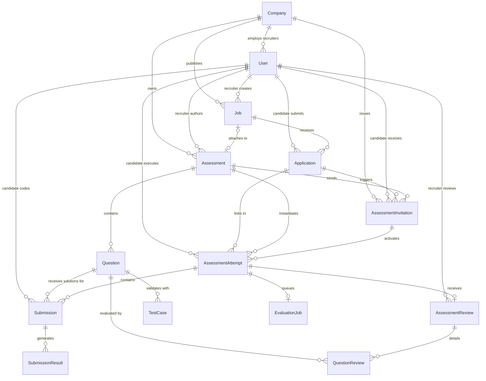

# DevHire — Database Architecture & Data Dictionary

This document details the relational data model for DevHire, powering candidate tracking, job requisitions, timed coding assessments, and manual rubric reviews using Prisma 7 and Neon Serverless PostgreSQL.

---

## 1. Entity-Relationship (ER) Diagram

---

## 2. Models & Data Dictionary

### 2.1 User
Represents both candidates and recruiters in the platform.

| Field | Type | Modifiers | Description |
|---|---|---|---|
| `id` | String | PK, UUID | Unique user identifier |
| `email` | String | Unique, Indexed | Login email address |
| `passwordHash` | String | Required | Salted bcrypt hash; plaintext never stored |
| `name` | String | Required | Full display name |
| `role` | Role | Default: `CANDIDATE` | Enum: `CANDIDATE`, `RECRUITER`, `ADMIN` |
| `avatarUrl` | String? | Optional | Profile image URL |
| `headline` | String? | Optional | Professional headline (e.g. "Senior Backend Engineer") |
| `bio` | Text? | Optional | Detailed professional summary |
| `resumeUrl` | String? | Optional | Hosted URL to candidate resume |
| `githubUrl` | String? | Optional | Public GitHub profile link |
| `linkedinUrl` | String? | Optional | Public LinkedIn profile link |
| `skills` | String[] | Default: `[]` | Array of technical skills |
| `companyId` | String? | FK, Indexed | Foreign key to `Company` (Recruiters only; null for candidates) |
| `createdAt` | DateTime | Default: `now()` | Account creation timestamp |
| `updatedAt` | DateTime | `@updatedAt` | Last update timestamp |

**Indexes & Constraints**:
- `@@unique([email])`
- `@@index([role])`
- `@@index([companyId])`

---

### 2.2 Company
Represents an employer organization publishing jobs and issuing assessments.

| Field | Type | Modifiers | Description |
|---|---|---|---|
| `id` | String | PK, UUID | Unique company identifier |
| `name` | String | Required | Legal or business display name |
| `slug` | String | Unique, Indexed | URL-friendly unique identifier |
| `logoUrl` | String? | Optional | Company logo image URL |
| `website` | String? | Optional | Official company website |
| `description` | Text? | Optional | Company overview and mission statement |
| `industry` | String? | Optional | Primary business vertical |
| `location` | String? | Optional | Company headquarters location |
| `createdAt` | DateTime | Default: `now()` | Record creation timestamp |
| `updatedAt` | DateTime | `@updatedAt` | Last update timestamp |

---

### 2.3 Job
Represents a technical job requisition.

| Field | Type | Modifiers | Description |
|---|---|---|---|
| `id` | String | PK, UUID | Unique job requisition identifier |
| `title` | String | Required | Job title |
| `slug` | String | Required | Unique slug within the company |
| `description` | Text | Required | Job description and responsibilities |
| `requirements` | Text | Required | Must-have and preferred qualifications |
| `location` | String | Required | Job geographic location |
| `locationType` | JobLocationType | Default: `REMOTE` | Enum: `REMOTE`, `HYBRID`, `ON_SITE` |
| `type` | JobType | Default: `FULL_TIME` | Enum: `FULL_TIME`, `PART_TIME`, `CONTRACT`, `INTERNSHIP` |
| `status` | JobStatus | Default: `DRAFT` | Enum: `DRAFT`, `PUBLISHED`, `CLOSED`, `ARCHIVED` |
| `salaryMin` | Int? | Optional | Minimum annual compensation |
| `salaryMax` | Int? | Optional | Maximum annual compensation |
| `currency` | String | Default: `"USD"` | Currency code |
| `experienceLevel`| String? | Optional | Seniority tier (e.g. "MID", "SENIOR", "STAFF") |
| `companyId` | String | FK, Indexed | Foreign key to `Company` (`onDelete: Cascade`) |
| `recruiterId` | String | FK, Indexed | Foreign key to `User` (`onDelete: Restrict`) |
| `assessmentId` | String? | FK, Indexed | Optional linked `Assessment` (`onDelete: SetNull`) |
| `createdAt` | DateTime | Default: `now()` | Requisition creation timestamp |
| `updatedAt` | DateTime | `@updatedAt` | Last modification timestamp |

**Indexes & Constraints**:
- `@@unique([companyId, slug])`
- `@@index([companyId])`
- `@@index([recruiterId])`
- `@@index([status])`
- `@@index([createdAt])`

---

### 2.4 Application
Represents a candidate's formal job application.

| Field | Type | Modifiers | Description |
|---|---|---|---|
| `id` | String | PK, UUID | Unique application identifier |
| `jobId` | String | FK, Indexed | Foreign key to `Job` (`onDelete: Cascade`) |
| `candidateId` | String | FK, Indexed | Foreign key to `User` (`onDelete: Cascade`) |
| `status` | ApplicationStatus | Default: `SUBMITTED` | Enum: `SUBMITTED`, `IN_REVIEW`, `ASSESSMENT_INVITED`, `ASSESSMENT_COMPLETED`, `SHORTLISTED`, `REJECTED`, `OFFERED` |
| `coverLetter` | Text? | Optional | Candidate cover letter or personal statement |
| `resumeUrl` | String? | Optional | URL to candidate resume uploaded at apply time |
| `notes` | Text? | Optional | Recruiter internal review notes |
| `createdAt` | DateTime | Default: `now()` | Application submission timestamp |
| `updatedAt` | DateTime | `@updatedAt` | Last status update timestamp |

**Indexes & Constraints**:
- `@@unique([jobId, candidateId])` — Guarantees a candidate cannot submit duplicate applications for the same requisition.
- `@@index([jobId])`
- `@@index([candidateId])`
- `@@index([status])`

---

### 2.5 Assessment
Represents a reusable technical assessment benchmark.

| Field | Type | Modifiers | Description |
|---|---|---|---|
| `id` | String | PK, UUID | Unique assessment identifier |
| `title` | String | Required | Assessment title |
| `description` | Text | Required | Assessment overview and candidate instructions |
| `durationMinutes`| Int | Default: `60` | Strict timer window allotted to the candidate |
| `passingScore` | Float | Default: `70.0` | Minimum score threshold percentage |
| `status` | AssessmentStatus | Default: `DRAFT` | Enum: `DRAFT`, `ACTIVE`, `ARCHIVED` |
| `companyId` | String | FK, Indexed | Foreign key to `Company` (`onDelete: Cascade`) |
| `creatorId` | String | FK, Indexed | Foreign key to `User` (`onDelete: Restrict`) |
| `createdAt` | DateTime | Default: `now()` | Assessment creation timestamp |
| `updatedAt` | DateTime | `@updatedAt` | Last update timestamp |

---

### 2.6 Question & TestCase
Defines coding problems and associated public / hidden test assertions.

#### Question
| Field | Type | Modifiers | Description |
|---|---|---|---|
| `id` | String | PK, UUID | Unique question identifier |
| `assessmentId` | String | FK, Indexed | Foreign key to `Assessment` (`onDelete: Cascade`) |
| `title` | String | Required | Question headline |
| `description` | Text | Required | Problem statement, constraints, and I/O specifications |
| `difficulty` | QuestionDifficulty| Default: `MEDIUM` | Enum: `EASY`, `MEDIUM`, `HARD` |
| `points` | Int | Default: `100` | Maximum points allocated |
| `timeLimitMs` | Int | Default: `2000` | Execution time limit per test case (ms) |
| `memoryLimitKb`| Int | Default: `262144`| Maximum heap memory limit (256 MB) |
| `starterCode` | Json? | Optional | Starter boilerplate per language |
| `orderIndex` | Int | Default: `0` | Sequence order within assessment |

#### TestCase
| Field | Type | Modifiers | Description |
|---|---|---|---|
| `id` | String | PK, UUID | Unique test case identifier |
| `questionId` | String | FK, Indexed | Foreign key to `Question` (`onDelete: Cascade`) |
| `input` | Text | Required | Input arguments or function parameters |
| `expectedOutput`| Text | Required | Expected output assertion |
| `isHidden` | Boolean | Default: `false` | When true, hidden from candidate UI; server-only |
| `explanation` | Text? | Optional | Contextual hint or explanation |
| `weight` | Float | Default: `1.0` | Relative point weight |

---

### 2.7 AssessmentInvitation & AssessmentAttempt
Tracks candidate invitations and active timed coding sessions.

#### AssessmentInvitation
| Field | Type | Modifiers | Description |
|---|---|---|---|
| `id` | String | PK, UUID | Unique invitation identifier |
| `assessmentId` | String | FK, Indexed | Assessment link |
| `candidateId` | String | FK, Indexed | Candidate link |
| `applicationId` | String | FK, Indexed | Application link |
| `companyId` | String | FK, Indexed | Company link |
| `invitedById` | String | FK | Recruiter who issued the invite |
| `status` | InvitationStatus | Default: `PENDING` | Enum: `PENDING`, `STARTED`, `COMPLETED`, `EXPIRED`, `REVOKED` |
| `expiresAt` | DateTime? | Optional | Link validity expiration |
| `startedAt` | DateTime? | Optional | When candidate initiated test |
| `completedAt` | DateTime? | Optional | When candidate finalized submission |

#### AssessmentAttempt
| Field | Type | Modifiers | Description |
|---|---|---|---|
| `id` | String | PK, UUID | Unique attempt session identifier |
| `assessmentId` | String | FK, Indexed | Assessment link |
| `candidateId` | String | FK, Indexed | Candidate link |
| `applicationId` | String? | FK, Indexed | Application link |
| `invitationId` | String? | FK, Indexed | Invitation link |
| `status` | AttemptStatus | Default: `NOT_STARTED`| Enum: `NOT_STARTED`, `IN_PROGRESS`, `SUBMITTED`, `EVALUATED`, `EXPIRED` |
| `score` | Float? | Optional | Final calculated score |
| `startedAt` | DateTime? | Optional | Timestamp when candidate clicked start |
| `expiresAt` | DateTime? | Optional | Strict server deadline (`startedAt + durationMinutes`) |
| `submittedAt` | DateTime? | Optional | Timestamp of submission |

---

### 2.8 Submission & AssessmentReview
Stores candidate code solutions and recruiter rubric assessments.

#### Submission
| Field | Type | Modifiers | Description |
|---|---|---|---|
| `id` | String | PK, UUID | Unique submission identifier |
| `attemptId` | String | FK, Indexed | Attempt link |
| `questionId` | String | FK, Indexed | Question link |
| `candidateId` | String | FK, Indexed | Candidate link |
| `language` | String | Required | Programming language (`typescript`, `python`, etc.) |
| `code` | Text | Required | Candidate submitted source code |
| `status` | SubmissionStatus | Default: `PENDING` | Enum: `PENDING`, `ACCEPTED`, `WRONG_ANSWER`, `TIME_LIMIT_EXCEEDED`, `COMPILATION_ERROR`, `RUNTIME_ERROR` |
| `score` | Float | Default: `0.0` | Assigned question score |

#### AssessmentReview
| Field | Type | Modifiers | Description |
|---|---|---|---|
| `id` | String | PK, UUID | Unique review identifier |
| `attemptId` | String | Unique, FK | Attempt link (One-to-One) |
| `reviewerId` | String | FK, Indexed | Recruiter reviewer link |
| `status` | ReviewStatus | Default: `DRAFT` | Enum: `DRAFT`, `PUBLISHED` |
| `totalScore` | Float | Default: `0.0` | Normalized percentage score (0-100) |
| `totalPoints` | Float | Default: `0.0` | Total points awarded |
| `pointsPossible`| Float | Default: `0.0` | Maximum points possible |
| `passed` | Boolean | Default: `false` | Whether score meets `assessment.passingScore` |
| `feedback` | Text? | Optional | Comprehensive recruiter feedback |
| `publishedAt` | DateTime? | Optional | Timestamp when review became visible to candidate |

#### QuestionReview
| Field | Type | Modifiers | Description |
|---|---|---|---|
| `id` | String | PK, UUID | Unique per-question review identifier |
| `reviewId` | String | FK, Indexed | Parent review link |
| `questionId` | String | FK, Indexed | Evaluated question link |
| `pointsEarned` | Float | Default: `0.0` | Points awarded |
| `pointsPossible`| Float | Default: `0.0` | Maximum points possible |
| `feedback` | Text? | Optional | Question-specific rubric feedback |

**Constraint**: `@@unique([reviewId, questionId])`

---

## 3. Data Integrity & Cascade Semantics

- **Cascade Delete (`onDelete: Cascade`)**:
  - Deleting an `Assessment` automatically cascades to delete all linked `Question` and `TestCase` records.
  - Deleting an `AssessmentAttempt` cascades to remove draft `Submission` and `AssessmentReview` rows.
  - Deleting a `Job` deletes all candidate `Application` records submitted to that job.
- **Restrict Delete (`onDelete: Restrict`)**:
  - A `User` who has authored published `Job` requisitions or created `Assessment` benchmarks cannot be deleted without reassigning or soft-deleting those entities first.
- **Set Null (`onDelete: SetNull`)**:
  - Deleting a `Company` sets `companyId = null` on recruiter profiles rather than corrupting user credentials.

---

## 4. Connection Pooling & Neon Security Configuration

All database queries are executed via `@prisma/adapter-pg` connecting to Neon PgBouncer transaction poolers:
- **Connection String**: Transformed at runtime to enforce `sslmode=verify-full`.
- **Root CA Trust**: Validates against system trust stores for TLS 1.3 cryptographic integrity.
- **Connection Reuse**: Cached in global memory during serverless cold-start cycles.
