# DevHire — Application Security & Defense-in-Depth

This document provides a thorough audit and technical analysis of the security posture, threat mitigation strategies, and defense-in-depth controls implemented across DevHire.

---

## 1. Security Architecture & Threat Model

DevHire enforces a multi-layered defense-in-depth architecture covering authentication, authorization, data isolation, transport security, and runtime constraints:

```mermaid
flowchart TD
    subgraph Layer1 ["1. Network & Transport Security"]
        TLS["HTTPS / TLS 1.3 Transport"]
        HSTS["HSTS (max-age=63072000; preload)"]
        CSP["Content Security Policy (CSP) & Security Headers"]
    end

    subgraph Layer2 ["2. Perimeter & Rate Limiting"]
        RateLimit["Upstash Redis Sliding Window Rate Limiter\n(5 req/15min register, 10 req/15min login)"]
        CSRF["Next.js Server Action CSRF Protection"]
    end

    subgraph Layer3 ["3. Authentication & Session Layer"]
        AuthJS["Auth.js v5 (NextAuth) Stateless JWT"]
        Cookies["HttpOnly, Secure, SameSite=Lax Session Cookies"]
        Bcrypt["bcryptjs Salted Password Hashing (Cost=10)"]
    end

    subgraph Layer4 ["4. Access Control & Authorization"]
        RBAC["Role-Based Access Control (Candidate vs Recruiter)"]
        MultiTenant["Company Multi-Tenant Isolation (companyId Scoping)"]
        DBVerify["Database-Authoritative Role Verification"]
    end

    subgraph Layer5 ["5. Assessment & Data Integrity"]
        HiddenTest["Server-Side Hidden Test Case Stripping"]
        ImmutableCode["Immutable Code Submissions Post-Deadline"]
        AtomicTx["Prisma $transaction Atomic Review Publishing"]
    end

    subgraph Layer6 ["6. Database & Persistence Layer"]
        NeonTLS["Neon PostgreSQL (strict sslmode=verify-full)"]
        PgBouncer["PgBouncer Transaction Pooler"]
    end

    Layer1 --> Layer2 --> Layer3 --> Layer4 --> Layer5 --> Layer6
```



---

## 2. Authentication & Credential Security

1. **Stateless JWT Sessions**:
   - Session tokens are stored in signed, encrypted JSON Web Tokens.
   - Cookies are configured with `HttpOnly: true` (inaccessible to JavaScript, mitigating XSS token theft), `Secure: true` (only transmitted over HTTPS), and `SameSite: "lax"` (mitigating cross-site request forgery).
2. **Salted Password Hashing**:
   - Plaintext passwords are never persisted to disk or logged.
   - Hashed using `bcryptjs` with a cost factor of 10 rounds, providing defense against offline rainbow table attacks.
3. **Prevention of Role Spoofing**:
   - High-privilege mutations in Server Actions re-verify the requesting user's identity and role against Neon PostgreSQL via `getVerifiedUserRole()`, neutralizing stale or manipulated JWT payloads.

---

## 3. Multi-Tenant Isolation & Authorization (RBAC)

DevHire prevents horizontal and vertical privilege escalation (IDOR) through rigorous multi-tenancy rules:

### 3.1 Recruiter Isolation
- Recruiters belong to a single `companyId`.
- Every database query for job creation, candidate pipeline access, and assessment management explicitly filters by `session.user.companyId`.
- A recruiter from Company A cannot query or alter candidates, requisitions, or reviews belonging to Company B:
  ```typescript
  // Example pattern enforced across recruiter Server Actions:
  const job = await prisma.job.findFirst({
    where: {
      id: jobId,
      companyId: session.user.companyId, // Strict tenant scoping
    },
  });
  if (!job) throw new Error("Unauthorized or Job not found.");
  ```

### 3.2 Candidate Isolation
- Candidates can only query applications and assessment attempts that match their authenticated `session.user.id`.
- Attempts to start or inspect another candidate's assessment session immediately return authorization rejections.

---

## 4. Assessment & Code Integrity Controls

### 4.1 Server-Side Hidden Test Case Protection
- Assessment questions contain both public and hidden unit test cases.
- In `getAttemptWorkspace`, the server strips all test cases where `isHidden: true` before serializing data to the client.
- Hidden test cases are never transmitted over the wire or present in client-side React state, eliminating client-side inspection vulnerabilities.

### 4.2 Server-Clock Deadline Enforcement
- When a candidate begins an assessment, `expiresAt` is calculated and persisted on the server: `expiresAt = NOW() + durationMinutes`.
- Draft autosave (`saveQuestionDraft`) and final submission (`submitAssessmentAttempt`) compare against the server's current timestamp.
- Altering system time on the candidate's browser has zero effect on deadline expiration.

### 4.3 Code Submission Immutability
- Once submitted (or when the server deadline lapses), the attempt status transitions to `SUBMITTED`.
- The database rejects any subsequent write or update operations on candidate code, ensuring historical accuracy and preventing post-submission tampering.

### 4.4 Atomic Review Publication
- Recruiter evaluations (question points, overall rubric score, feedback, and application hiring decision) are executed inside a Prisma interactive transaction (`$transaction`).
- This guarantees that review creation, attempt status transition (`EVALUATED`), and candidate application progression (`SHORTLISTED` or `REJECTED`) occur atomically. In the event of a network failure, the transaction rolls back cleanly with zero partial state.

---

## 5. Transport & Network Security

### 5.1 Strict PostgreSQL TLS Validation (`sslmode=verify-full`)
In `src/lib/prisma.ts`, connection strings are dynamically rewritten to enforce `sslmode=verify-full` via `@prisma/adapter-pg`:
- Disallows insecure connection fallback.
- Validates the server certificate against Neon's CA root trust store, mitigating Man-in-the-Middle (MITM) attacks between Vercel serverless runtimes and the database pooler.

### 5.2 HTTP Security Headers
Configured in `next.config.ts` across all incoming routes:

| Header | Configured Value | Purpose |
|---|---|---|
| `Content-Security-Policy` | Strict script, style, and frame boundaries | Mitigates XSS injection |
| `Strict-Transport-Security` | `max-age=63072000; includeSubDomains; preload` | Forces HTTPS for 2 years |
| `X-Frame-Options` | `DENY` | Prevents clickjacking in iframes |
| `X-Content-Type-Options` | `nosniff` | Blocks MIME-type sniffing |
| `Referrer-Policy` | `origin-when-cross-origin` | Protects sensitive URL params |
| `Permissions-Policy` | `camera=(), microphone=(), geolocation=()` | Disables invasive hardware APIs |

---

## 6. Rate Limiting & Abuse Prevention

- **Upstash Redis Sliding Window**:
  - `registerCandidate` & `registerRecruiter`: Limited to 5 requests per 15-minute sliding window per IP.
  - `loginUser`: Limited to 10 requests per 15-minute sliding window per IP.
- **Fail-Safe In-Memory Fallback**:
  - If Redis credentials are unconfigured or experiencing upstream connectivity dropouts, the rate limiter automatically falls back to an in-memory token bucket, preventing unauthenticated denial of service.

---

## 7. Dependency Security & Vulnerability Analysis

A comprehensive security scan (`npm audit`) was executed against all installed packages:

### 7.1 Resolved Vulnerabilities
- **DOMPurify CVEs**: `dompurify` was patched and verified with `isomorphic-dompurify@2.36.0`, neutralizing cross-site scripting risks during markdown previewing.

### 7.2 Disclosed DevDependency Advisory
- **Advisory**: `GHSA-7589-6fvf-x4pw` (High Severity ReDoS in `effect <= 3.22.0`).
- **Location**: DevDependency tree under `@prisma/config` (Prisma 7 CLI configuration tooling).
- **Risk Assessment**: **Zero Production Runtime Impact**.
  - `@prisma/config` is exclusively utilized at build/compile time by the Prisma CLI on developer machines and Vercel build workers.
  - The `effect` package is never bundled, exported, or executed within client browser bundles or Vercel production serverless functions.
  - Attempting to force-downgrade `effect` breaks Prisma 7 CLI configuration schemas. The risk is documented and contained.

---

## 8. Explicit Non-Claims & Safety Guarantees

In accordance with strict technical integrity:
- **No Untrusted Code Execution on Host**: DevHire employs an expert-driven manual review model with candidate code inspection. Remote sandbox code execution (e.g. Judge0 integration) is intentionally not enabled in the current release, entirely eliminating server-side Remote Code Execution (RCE) vectors.
- **No Mock Security**: All access control and rate-limiting measures run live in production against real database and Redis infrastructure.
